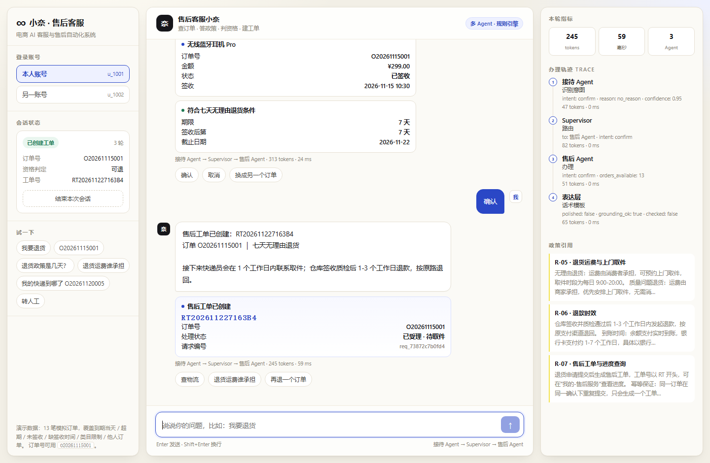

# 电商 AI 智能客服与售后自动化系统

AGI Nexus「AI 应用开发 / 电商项目实战」8 周课程项目落地：**用一条退货流程，练知识检索、工具调用、状态编排与上线验收。**

客服 Agent 能查订单、按政策回答、判断退货资格、展示确认摘要、创建售后工单，并在重复点击、响应丢失、换单、越权等异常下给出正确结果。



> 截图是 `/?demo=1` 一键演示的最后一屏：确认摘要、资格卡片、工单卡片、右侧办理轨迹与政策引用。

---

## 1. 30 秒跑起来

```bash
cd ecom-agent
pip install -r requirements.txt

# 离线模式（默认，不需要任何 API Key）
python -m uvicorn app.main:app --port 8000
```

打开 http://127.0.0.1:8000 ，说「我要退货」，订单号用 `O20261115001`。
一键看完整流程：http://127.0.0.1:8000/?demo=1

接入真实大模型（可选，只要 OpenAI 兼容协议即可）：

```bash
cp .env.example .env      # Windows: copy .env.example .env
# 编辑 .env：AGENT_LLM_MODE=llm，填 LLM_BASE_URL / LLM_API_KEY / LLM_MODEL
python scripts/check_llm.py    # 自检：连得上 / key 有效 / 模型可用 / 响应带 usage
```

第三方聚合网关（诺联 API、NuoAPI、OpenRouter 等）同样走 OpenAI 兼容协议，改三行就能接：

```ini
AGENT_LLM_MODE=llm
LLM_BASE_URL=https://<站点域名>/v1     # 以浏览器地址栏为准，别填同名营销页
LLM_MODEL=claude-haiku-4-5             # 模型广场的名字原样抄，大小写/连接符都不能改
LLM_PRICE_MULTIPLIER=0.3               # 控制台该令牌分组显示的倍率
```

`check_llm.py` 会把 `401 / 404 / 429` 翻成具体排查动作（key 无效、路径不对、限流），并告诉你响应里有没有 `usage`（决定能不能计费）。key 只写在 `.env`（已在 `.gitignore` 里），不要提交、不要贴进截图或文档。

真实网关实测：`claude-haiku-4-5` 已通过 `/v1/models` 与 `/v1/chat/completions` 校验，响应带完整 `usage`，`check_llm.py` 全绿；端到端 4 轮对话成功建单，理解层与表达层都是 `source=llm` 的实测调用。真实模型每轮约 2 次调用，**耗时波动很大**（B1 抽样实测单轮 9–69 秒、均值 17.4 秒，早期只跑 4 轮时看到的 13–16 秒不能代表整体）；规则模式仍是毫秒级，随时可把 `AGENT_LLM_MODE` 改回 `rules`。真实模型到底让效果变好还是变差，见第 7 节 B1 基线。

### 多模型路由：理解层用免费模型，表达层继续 Claude

多 Agent 拆分后，两个环节对模型的要求其实不同：**意图识别**只输出一个 JSON（轻、容错高），**话术润色**直接决定回复质量（重、要保事实）。所以可以让理解层走**免费模型**、表达层继续走 Claude（`claude-haiku-4-5` 原配置完全保留），在不明显掉质量的前提下把 token 成本压下来。

**当前项目已接入并实测通过**：理解层走智谱免费模型 `glm-4-flash-250414`，表达层仍走 Claude `claude-haiku-4-5`（原配置完全保留）。`/api/health` 里 `classify_routed=true`、`classify_model=glm-4-flash-250414`、`model=claude-haiku-4-5`。一次真实对话的 trace 显示：`接待 Agent` 用 `glm-4-flash-250414`（实测 408 tokens，单价 0），`表达层` 用 `claude-haiku-4-5`（实测 254 tokens，按 0.3 倍率计费），整轮估算费用 0.000972 元——理解层那部分完全不花钱。

配置方式（三个 `CLASSIFY_*` 必须齐备才生效，缺任意一个自动回退主模型；真实 key 只存本地 `.env`，已被 git 忽略）：

```ini
# 智谱 GLM-4-Flash：永久免费、128K、国内直连（推荐）
CLASSIFY_BASE_URL=https://open.bigmodel.cn/api/paas/v4
CLASSIFY_API_KEY=<在 open.bigmodel.cn 控制台申请>
CLASSIFY_MODEL=glm-4-flash-250414   # 当前可用版本；旧别名 glm-4-flash 也可用
CLASSIFY_PRICE_IN_PER_1K=0    # 免费模型单价填 0，避免虚报费用
CLASSIFY_PRICE_OUT_PER_1K=0

# 主模型不动，继续负责润色
LLM_BASE_URL=https://nodlink.cn/v1
LLM_MODEL=claude-haiku-4-5
```

> 注：`glm-4.7-flash` 同样免费，但实测高峰返回 429「访问量过大」，稳定优先选 `glm-4-flash-250414`。该免费版本不在 `/models` 列表里，但 `/chat/completions` 可正常调用——自检脚本以真实对话为准，不会因它没进列表误判失败。

其它可选免费模型（同样 OpenAI 兼容）：硅基流动 `Qwen/Qwen3-8B`（`https://api.siliconflow.cn/v1`）、本地 Ollama `qwen2.5:7b`（`http://localhost:11434/v1`，key 随便填）。价目表已内置这几个免费模型单价 0。

接入后先自检：`python scripts/check_llm.py --role classify`（检查理解层）、`python scripts/check_llm.py`（检查主模型）。

**省钱又不掉质量的原理**（与项目一贯的分层一致：模型只管理解与表达，规则留在代码里）：

- 理解层就算用便宜模型判错，还有 `needs_state_correction()` 意图状态硬护栏 + 规则兜底（B1/B2 验证过），不会因为省钱把流程搞乱；
- 表达层仍由 Claude 润色，且经过 grounding 关键短语校验（B3 验证过），回复质量与事实完整性不降级；
- 计费层按每个 step 的实际模型分别取价：`usage.pricing_by_model` 会分别列出 `classify:glm-4-flash-250414`（单价 0）与 `main:claude-haiku-4-5` 的用量，估算费用只算主模型那部分；免费模型不套主网关倍率。

全新克隆、尚未填 key 时（未配置 `CLASSIFY_*`），理解层跟随主模型，行为与单模型完全一致——所以旧测试和线上行为都不会受影响。`tests/conftest.py` 会占位压住本地真实 key，保证回归测试永远打不到外网。`tests/test_model_routing.py`（9 项）锁住路由、计费与降级纪律。

### 界面上的模型切换器

聊天头部那个 `多 Agent · Claude Haiku 4.5` 徽章现在**可以点击**，展开后**表达层（话术润色）和理解层（意图识别）各自都能从已配置模型里任选一个**，点选即时生效、下一条消息起按新模型走，**不用改 .env、不用重启服务**。

- 后端：`GET /api/models` 列出脱敏后的选项与当前选择；`POST /api/models/switch`（`{"role":"main"|"classify","model_id":"..."}`）做运行时切换。`/api/health` 的 `model` / `classify_model` 显示的是运行时实际生效值，`model_options` 给出选项。
- 连接参数（base_url / key / 单价 / 倍率）绑定在 `app/model_registry.py` 的每个模型档位上，切换时整套套用；计费按 trace 里的**实际模型名**取价（`build_turn_usage` 的 `model_pricing` 参数），所以把 Claude 切到理解层就会按 Claude 单价计费，绝不会误算成免费。
- 选项脱敏：`api_key` 只留在服务端内存，`/api/models` 与 `/api/health` 都不含密钥。
- 边界：规则模式没有可切换模型时徽章不可点；对话进行中会禁用切换按钮，避免半途换模型；切换是运行时状态，重启服务后回到 `.env` 的默认配置。
- 安全底座（2026-11-25 新增，默认全关以兼容课程演示）：`AGENT_RBAC_ENABLED=1` + `AGENT_AUTH_SECRET` + `AGENT_STAFF_ACCOUNTS` 开启 strict 模式后，坐席接口只信 `X-Staff-Token` 签名 token，请求体里的 `assignee` / `operator` / `X-Agent-Name` 全部忽略；角色 viewer < agent < supervisor < admin，分别对应只读、认领/回复/回写状态、归档、切模型/登录。限流用 `AGENT_RATE_LIMIT_PER_MIN` 及各接口单独上限，进程内滑动窗口，超限 429 + `Retry-After`。strict 模式下工作台顶部出现「坐席登录」入口，`POST /api/auth/login` 校验账号表并同时签发用户 token 与坐席 token；多实例部署需把限流计数换成 Redis。测试见 `tests/test_security.py`（21 项）。
- 测试：`tests/test_model_switch.py`（9 项）锁住脱敏、切换行为、会话状态不变与「计费跟随实际模型」。全量 650 项通过。

跑测试与评测：

```bash
python -m pytest -q                      # 755 项验收（含状态回写/坐席台/埋点漏斗/安全底座/B4–B7 断言口径与槽位校验/B12 状态型问句/B13 引用完整性/产品闭环/售后诊断/订单源接入/坐席 Copilot/架构进阶/外部依赖替身）
python scripts/run_eval.py               # 48 条全量对比（默认规则模式，加 --llm 才走真实模型）
python scripts/run_holdout5_llm.py --smoke # holdout5 真实模型基线：先验证真的发生 LLM 调用
python scripts/run_holdout5_llm.py         # holdout5 真实模型全量基线（独立报告，不改 .env）
python scripts/run_llm_baseline.py       # B1：10 条抽样上「真实模型 vs 规则引擎」，真实调用需费用
python scripts/run_llm_baseline.py --sample2       # B2：修复后另开一轮新建样本的复测
python scripts/run_llm_baseline.py --sample3       # B3：润色丢词修复后的复测
python scripts/run_llm_baseline.py --sample4       # B4：同义断言口径修复后的定向探针复测
python scripts/run_llm_baseline.py --sample5       # B5：语素信号组合修复后的定向探针复测
python scripts/run_llm_baseline.py --sample6       # B6：完成型结论（建单确认）规格修复后的定向探针复测
python scripts/run_llm_baseline.py --sample7       # B7：reason 槽位证据校验修复后的定向探针复测
python scripts/run_llm_baseline.py --rules-only    # 只跑规则侧，离线自检
python scripts/run_llm_baseline.py --analyze-only  # 复用已生成报告做口径诊断，不调 API
```

---

## 2. 演示脚本（对着界面讲 3 分钟）

| 步骤 | 你说 | 系统做什么 | 讲什么 |
|---|---|---|---|
| 1 | 我要退货 | 追问订单号，进入「等待订单号」 | 多轮状态机，不是一问一答 |
| 2 | O20261115001 | 查单 → 判期限 → 展示确认摘要 + 条款 R-01/R-05 | 今天到期也能退，签收日不计入 |
| 3 | 确认 | 建单，返回工单号 RT… | 幂等键 = 会话 + 订单 + 确认令牌 |
| 4 | 换成 O20261116013 | 换单后重新核单，旧确认自动失效 | 服务端校验令牌，不信前端 |
| 5 | 切换到「另一账号」再查 O20261112008 | 拒绝：订单不在当前账号 | 越权拦截 + 安全事件留痕 |

其它可讲的边界：超期（O20261115002）、未签收（O20261120005）、定制类目（O20261118004）、签收时间缺失（O20261119010）、已退款（O20261114011）、未发货（O20261121007）。

---

## 3. 目录结构

```
ecom-agent/
├── app/
│   ├── main.py                 # FastAPI：/api/chat、/api/health、/api/usage、会话与工单查询
│   ├── config.py               # 环境变量集中配置（部署只改 .env）
│   ├── db.py                   # SQLite：会话、工单（唯一约束+状态版本）、事件日志、人工队列
│   ├── llm.py                  # 意图语义信号层 + 规则引擎 / OpenAI 兼容接口（采集 usage），失败自动降级
│   ├── slots.py                # 槽位证据校验：reason（B7）/ 订单号格式（B9）
│   ├── identity.py             # 身份源协议：账号表（默认）/ SSO 签名码沙箱
│   ├── ratelimit.py            # 限流协议：进程内滑窗（默认）/ 可注入 Redis
│   ├── sla_scheduler.py        # SLA 调度协议：拉队列触发（默认）/ 后台定时
│   ├── usage.py                # Token 实测/估算口径、单价解析、会话级用量汇总
│   ├── model_registry.py       # 可切换模型注册表（脱敏、单价绑定）
│   ├── domain/
│   │   ├── orders.py           # 订单、物流、退货资格判定（纯函数）
│   │   ├── rag.py              # 条款切分 + BM25 + 条款引用
│   │   ├── tickets.py          # 幂等建单 + 状态回写服务（乐观锁/幂等/时间线）
│   │   ├── status.py           # 工单状态枚举与迁移白名单（A/B 共用协议）
│   │   ├── events.py           # 统一事件字典 + PII 脱敏（A/B/C 共用协议）
│   │   ├── agent_desk.py       # 人工坐席队列：入队/认领/回复/归档/SLA（事项 B）
│   │   └── funnel.py           # 埋点写入与漏斗聚合（事项 C）
│   ├── agent/
│   │   ├── advice.py           # 先答题再要单：情形识别 / 追问承接 / 订单提议 / 条款摘句
│   │   ├── tools.py            # 6 个工具的 JSON Schema 与服务端校验（含 query_ticket_status）
│   │   ├── flow.py             # 状态机 + 退货办理流程 + 进度查询
│   │   └── coordinator.py      # Supervisor 真实编排（逐步实测耗时 + 工具链 + handoff）/ 单 Agent 兜底
│   ├── data/                   # 13 笔模拟订单、物流、8 条政策条款
│   ├── eval/                   # 48 条全量（dev/dev2/holdout2）+ 独立 holdout3/holdout4/holdout5 + 探针集 + 评测器
│   └── static/
│       ├── index.html          # 客服工作台（原生 HTML/CSS/JS，无构建）
│       ├── desk.html           # 坐席工作台（队列/认领/回复/归档）
│       └── metrics.html        # 埋点漏斗看板
├── tests/                      # 755 项验收测试
├── scripts/run_eval.py         # 命令行评测
└── docs/screenshot.png
```

---

## 4. 8 周课程 → 代码与验收对照

| 周 | 课程内容 | 本项目实现 | 对应验收 |
|---|---|---|---|
| 第 1 周 | Python 与业务规则 | `domain/orders.py`：JSON 读单、按单号查、签收时间算期限、地址脱敏 | `tests/test_orders.py`：第 7 天可退 / 第 8 天超期 / 未签收 / 缺签收时间 |
| 第 2 周 | 网页接入大模型 | `main.py` + `static/index.html`：聊天接口、参数校验、错误提示 | `tests/test_api.py`：空消息 422、超长 422、会话查询 |
| 第 3 周 | RAG | `domain/rag.py`：条款切分、BM25 检索、Top-K、条款编号引用、无命中转人工 | `tests/test_rag.py`：R-01/R-02/R-05 命中，无命中转人工 |
| 第 4 周 | Function Calling | `agent/tools.py`：5 个工具 + JSON Schema + 参数/归属校验 | 越权、查无订单、非法参数、未知工具 |
| 第 5 周 | 多轮与状态管理 | `agent/flow.py`：FSM（6 状态）+ SQLite 持久化 + 换单失效 | 刷新继续办理、换单旧令牌失效、非法迁移拦截 |
| 第 6 周 | 防止重复建单 | `domain/tickets.py`：幂等键 + 唯一约束 + 事务 + 尝试日志 | 响应丢失后重试只返回原工单，工单数=1 |
| 第 7 周 | 多 Agent 与评测 | `agent/coordinator.py`：Supervisor + 接待/政策/售后**真实调用链**（逐步实测耗时、工具链、handoff）+ `app/usage.py` 计费口径；`eval/` 48 案例（dev / dev2 / holdout2 三段）+ 四层断言评测器 | 全量严格成功率：单 91.7% → 多 100%；未调参留出集 holdout2：93.8% → 100%；规则模式实测 token / 费用恒为 0 |
| 第 8 周 | 部署与验收 | 环境变量、Uvicorn、`/api/health`、SQLite 持久化、回归测试 | 重启进程后会话与工单仍在；全量回归 650 项通过 |

---

## 5. 九个关键设计

**① 模型负责理解与表达，代码负责规则与状态。**
LLM 只做两件事：识别意图/抽槽位、润色话术。期限计算、资格判定、建单全在代码里。润色之后的输出还要过一道事实校验（见 ⑥），所以金额、天数、工单号不会出现幻觉。理解层的结论也不是照单全收：`intent` 有状态硬护栏（模型在错误状态判 `confirm` 会凭空建单），`reason` 有证据校验（`app/slots.py`，声称质量问题必须在原话里有缺陷证据，否则降级成无理由——否则「刻字了能退吗」会被当成质量缺陷，绕过定制类目限制、错给 15 天通道）。两层护栏都只做减法，模型越权时降级给规则引擎的结论，用量仍记这次真实调用。LLM 调用失败自动降级到规则引擎，接口不会 500。

**② 确认令牌 + 服务端状态校验，前端伪造不了。**
判资格通过后服务端生成一次性 `confirm_token`，建单时必须同时满足：状态是 `AWAIT_CONFIRM`、令牌与当前令牌一致、订单与令牌一致。换单会立刻让旧令牌失效。

**③ 幂等键 = 会话 + 订单 + 确认令牌。**
`INSERT OR IGNORE` + `UNIQUE(idempotency_key)`，重试返回原工单。故障演练（`SIMULATE_RESPONSE_LOSS=1`）会在落库后丢弃一次响应，用来验证"用户再点一次也只返回同一个工单号"。

**④ 多 Agent 拆的是"理解"，不是"流程"，但每一步都真实执行。**
接待 Agent 判断意图并把槽位显式交给下游，Supervisor 记录路由、把 `handoff` 真正交给下游，政策 Agent 自己检索条款、售后 Agent 驱动状态机与工具链。评测里两边共用工具与状态机，差异只来自理解层，比较才公平。真实调用链与计费口径见 ⑨。

**⑤ 整轮对话串行化 + 服务端身份归属校验。**
`Coordinator.chat` 按 `session_id` 加锁，把「读会话 → 状态机 → 写回」包成临界区；确认令牌有 10 分钟 TTL，且建单前会重新复核资格；所有查询接口强制校验会话归属，配置 `AGENT_AUTH_SECRET` 后 `user_id` 只从 HMAC 签名 token 解析，客户端传参不再可信。进程崩溃留下的 `CREATING` 会话会在启动时自动恢复。

**⑥ 表达层事实校验：模型只改措辞，事实不许动。**
`polish()` 之后跑一次纯函数护栏（`app/grounding.py`）：从代码模板抽取订单号 / 工单号 / 条款号，以及金额、日期、时效等关键数值，逐项比对模型输出。删事实、造单号、改金额、加政策外承诺、把「拒绝」反写成「已办理」、把「需提供」弱化成「建议提供」（义务强度翻转，双向）、复述提示词、异常超长——任一命中就**整体回退模板**，并把 `grounding_rejected` 写进事件日志，`meta.grounding` 与轨迹面板同步可见。提示词里的「不得增删」只是软约束，护栏才是硬约束；规则模式不改写，直接短路，零开销。

**⑦ 评测按「是否参与调参」分段，留出集用过一次就要换新的。**
现在有 dev（参与调参）、dev2（原留出集，被「修意图召回」那轮消耗掉）、holdout2（修复后新建、未参与任何调参）三段。只有 holdout2 的成绩可以外推；另有测试检查留出集整句没有泄漏进分类器源码，防止照着留出集刷分。严格口径用四层断言共 875 项替代旧的 97 项，并同时输出新旧两套通过率。详见第 7 节。

**⑧ 意图识别用「语义信号」而不是「短语表」。**
`app/llm.py` 把一句话拆成可组合的语素：疑问/咨询标记 + 政策维度词判 `policy`（问规则），动词「退」/ 换货 / 质量问题带订单号判 `return`（办业务），物流词优先于裸单号；疑问句也不会被当成「确认」而误建单。词表里没有一句评测案例的原句，所以「我想把耳机退了」「能退吗 O…」「退货要自己付邮费吗」这类没见过的说法也能正确分流。单 / 多 Agent 共用这层信号，差异只保留在纯口语词的覆盖宽度上。

**⑨ 真实编排 + 真实计费口径，不拿估算冒充账单。**
`app/agent/coordinator.py` 把每个 Agent 步骤包成一次真实函数调用：耗时用 `perf_counter` 实测（浮点保留 3 位，不再有写死的 `ms: 0` 空壳），工具调用经 `ToolRegistry.on_call` 回填到该步骤的 `detail.tools`，Supervisor 产出的 `handoff` 由下游真正消费（政策 Agent 的检索结果直接成为状态机输入，不重复检索）；`meta.orchestration` 记录依赖顺序与逐步耗时。用量侧，`app/usage.py` 规定**只有 API 响应的 `usage` 字段算实测**（`prompt_tokens` / `completion_tokens`），规则模式、调用降级、无 `usage` 响应一律只有 prompt 字符估算且 `billable=false`；`estimated_cost_cny` 按可配置单价换算，是估算费用不是供应商账单，未配置单价时返回 `None`；聚合网关按「官方价 × 分组倍率」计费，倍率用 `LLM_PRICE_MULTIPLIER` 表达（如 `0.3`），token 数不受倍率影响。`/api/usage` 汇总会话级口径，前端轨迹面板逐步标注「实测 / 估算」、真实耗时与工具次数。规则模式下实测 token 与费用**恒为 0**。

---

## 6. 接口

| 方法 | 路径 | 说明 |
|---|---|---|
| GET | `/` | 客服工作台 |
| GET | `/api/health` | 健康检查：订单数、条款数、工单数、运行模式、`auth_mode`、`grounding_enabled`、`pricing_configured`、`price_multiplier`、业务参数 |
| POST | `/api/auth/token` | 演示签发身份 token；signed 模式返回 HMAC 签名 token，demo 模式返回 `token: null` |
| POST | `/api/auth/login` | 坐席登录；strict 模式校验账号表，返回用户 token + 坐席 token + 角色；demo 模式免密 |
| POST | `/api/chat` | `{session_id, user_id, message}`（signed 模式下 `user_id` 被忽略，只信 `Authorization: Bearer`）→ 回复、状态、槽位、轨迹（逐步实测耗时 / 用量 / 工具链）、引用、工单；`meta.grounding` 给出事实校验结果、`meta.orchestration` 给出编排链、`usage` 给出计费口径 |
| GET | `/api/sessions/{id}?user_id=` | 会话当前状态；必须带身份，且校验会话归属 |
| POST | `/api/sessions/{id}/reset?user_id=` | 重置会话；校验归属，跨账号 403 |
| GET | `/api/tickets?session_id=&user_id=` | 工单列表；强制按 `user_id` 过滤，无身份 401 / 跨用户 403 |
| GET | `/api/trace/{id}?user_id=` | 事件日志；同样强制归属校验 |
| GET | `/api/usage?session_id=&user_id=` | 会话级 Token 用量汇总：实测调用数 / prompt / completion token、估算 token、估算费用；无身份 401 / 跨用户 403 |

**事项 A｜工单状态回写**（`/desk` 与客服端共用一份状态）

| 方法 | 路径 | 说明 |
|---|---|---|
| GET | `/api/ticket-statuses` | 状态枚举、迁移白名单、下一步说明（坐席/前端共用协议） |
| GET | `/api/tickets/{id}?user_id=` | 工单详情：当前状态 + 时间线 + 更新时间 + 下一步；跨用户 403 |
| POST | `/api/tickets/{id}/status` | `{status, operator, idempotency_key?}` 回写状态；非法跃迁 409、重复幂等键不加版本号、并发冲突 409 |

状态机 `CREATED → REVIEWING → APPROVED → RECEIVED → REFUNDED`，终态 `REJECTED / CLOSED`；乐观锁 + 幂等键保证并发只生效一次。用户问"退货到哪一步"时，Agent 调 `query_ticket_status` 工具只回答库里的真实状态与时间戳。

**事项 B｜坐席工作台**（页面 `/desk`）

| 方法 | 路径 | 说明 |
|---|---|---|
| GET | `/api/desk/queue?state=&assignee=&only_overdue=` | 队列列表与筛选（转人工时打包最近对话、槽位、工单号、SLA） |
| GET | `/api/desk/queue/{qid}` | 记录详情与交接上下文 |
| POST | `/api/desk/queue/{qid}/claim` | `{assignee}` 认领；同一会话互斥，重复认领 409 |
| POST | `/api/desk/queue/{qid}/reply` | `{assignee, text}` 回复；写入原会话 `human_replies`，Agent 消息不覆盖 |
| POST | `/api/desk/queue/{qid}/resolve` | 结束归档 |

SLA 默认 5 分钟未认领自动打超时标记，列表可按超时筛选。坐席回复通过会话视图回写，用户在原会话可见。

**事项 C｜埋点漏斗**（页面 `/metrics`）

| 方法 | 路径 | 说明 |
|---|---|---|
| GET | `/api/metrics/funnel?from=&to=` | 6 节点转化漏斗（会话开始→意图识别→查单→资格判定→确认→建单）与各失败/转人工分支 |
| GET | `/api/metrics/by-mode` | 单/多 Agent 分组的轮次、成功率、平均耗时、估算/实测 Token |
| GET | `/api/metrics/event-dict` | 统一事件字典（A/B/C 共用） |

埋点用幂等 `event_id`，刷新/重试不重复计数；负载按 `domain/events.py::sanitize` 脱敏（去手机号/地址/身份证，无 PII 键）；写失败降级，聊天接口仍返回 200。漏斗按会话取"最深到达节点"累积，保证各节点人数单调不增。

**产品闭环｜自助进度 / SLA 通知 / 坐席增强**（页面 `/portal`，工作台第 4 个 tab）

| 方法 | 路径 | 说明 |
|---|---|---|
| GET | `/portal` | 自助进度页：不问客服也能查自己的工单 |
| GET | `/api/portal/tickets?user_id=` | 按身份查该用户**全部**工单，不依赖 `session_id`；demo 显式传 `user_id`，strict 只信签名 token |
| GET | `/api/tickets/{id}?user_id=` | 工单详情：状态 + 流转时间线 + 下一步（进度页复用，跨用户 403） |
| GET | `/api/desk/quick-replies` | 6 条快捷回复模板 + 可转派坐席名单 |
| POST | `/api/desk/queue/{qid}/reassign` | `{assignee}` 转派；写 `agent_reassign` 审计事件、幂等、已归档拒绝；strict 需 supervisor 及以上 |
| GET | `/api/desk/sla-status` | 通知配置状态（只暴露布尔开关，不泄露 webhook 密钥）+ 最近通知的 queue_id |
| POST | `/api/desk/sla-check` | 手动触发 SLA 超时扫描与通知（也可挂定时任务） |

SLA 通知走 `app/notify.py` 的企业微信群机器人 webhook：拉队列时 `db.mark_overdue_records()` 只返回**本次新超时**记录，天然去重不刷屏；消息卡片经 `domain/events.py::sanitize` 脱敏，发送失败只记 `sla_breach` 事件、不影响聊天与队列主流程。默认 `AGENT_WECOM_WEBHOOK` 为空 → `notifier_configured=False`，通知静默关闭，零配置演示不会向外发请求；配置后可用 `AGENT_SLA_NOTIFY=0` 随时关停，超时阈值 `AGENT_SLA_ALERT_MINUTES`（默认 5 分钟）。自助进度页在 demo 模式依赖显式 `user_id` 做归属隔离（课程演示需要切换账号），真实部署须开 `AGENT_AUTH_SECRET` 走签名 token——这与现有查询接口是同一条已知边界。

**决策产品｜售后诊断**（页面 `/diagnose`，工作台第 2 个 tab）

| 方法 | 路径 | 说明 |
|---|---|---|
| GET | `/diagnose` | 诊断页：输入问题与订单号，查看结论、事实、条款证据、缺口、边界与动作 |
| POST | `/api/aftersale/diagnose` | 生成诊断报告：复用核单工具与条款检索，返回 `decision_id`；不读不写订单状态 |
| POST | `/api/aftersale/execute` | 执行 `create_ticket` / `handoff`：必须携带 `decision_id` + 精确确认语，执行前重新核单 |

诊断层（`app/agent/diagnosis.py`）把已有能力收口成一份可执行决策：订单事实来自 `check_return_eligibility`（含归属校验），规则依据来自 `PolicyIndex` 的真实条款，诉求通道由 `detect_reason` + `validate_reason` 的缺陷证据决定，结论分「可申请 / 需补充 / 需人工 / 不可自助」。显式边界写进报告本身：不自动退款、不改订单、描述里匹配出的订单只能阅读不能执行、越权直接拒绝。执行动作复用 `ReturnFlow` 的 `AWAIT_CONFIRM → CREATING → TICKETED` 状态机，重复执行返回原工单；转人工走同一套队列与留痕。`decision_id` 30 分钟过期，过期或订单/诉求变化必须重新诊断。

**数据接入｜可插拔订单源**（默认零配置，配置后才切换后端）

| 方法 | 路径 | 说明 |
|---|---|---|
| GET | `/api/orders?user_id=&limit=&status=` | 列出当前登录用户自己的订单；signed 模式忽略传入的 `user_id`，只信 token |
| GET | `/api/health` | `order_source` / `order_source_detail` 显示当前源、条数与错误 |

订单源（`app/domain/order_sources.py`）把平台记录统一转换成内部 `Order`，后面的核单、资格判定、状态机、工单和诊断层都不用改：

- `json`（默认）：继续读 `app/data/orders.json`，演示与全部评测口径逐字不变；
- `csv`：直接读平台导出的表格，示例 `app/data/orders_douyin_sample.csv` 用抖音常见的 `order_no/buyer_id/product_name/pay_amount/order_status/sign_time` 表头；`python scripts/import_orders.py --input app/data/orders_douyin_sample.csv --dry-run` 可先预览，去掉 `--dry-run` 则生成 `data/orders_imported.json`；
- `http`：真实订单 API 通用骨架，GET JSON（支持数组或 `orders/data/items/list` 包装），Bearer token、`AGENT_ORDER_SOURCE_FIELD_MAP` 覆盖字段别名。接抖店开放平台时只需按拿到的权限包填映射，不需要改业务代码。

```bash
# 方式 A：离线 CSV 直接接入
AGENT_ORDER_SOURCE=csv AGENT_ORDER_SOURCE_PATH=app/data/orders_douyin_sample.csv \
  python -m uvicorn app.main:app --reload

# 方式 B：先转换成内部 JSON，再像演示数据一样加载
python scripts/import_orders.py --input app/data/orders_douyin_sample.csv --output data/orders_imported.json
ORDERS_PATH=data/orders_imported.json python -m uvicorn app.main:app --reload

# 方式 C：真实 API（字段映射按需覆盖）
AGENT_ORDER_SOURCE=http AGENT_ORDER_SOURCE_URL=https://.../orders \
  AGENT_ORDER_SOURCE_TOKEN=... AGENT_ORDER_SOURCE_FIELD_MAP='{"order_id":"out_order_no"}' \
  python -m uvicorn app.main:app --reload
```

硬边界：`user_id` 必须能映射到本系统登录身份，缺失即拒绝整批订单，不会替用户猜归属；未知状态同样拒绝，避免「退款中」被当成「已签收」。外部源故障时工具与诊断明确返回「订单源暂不可用」（HTTP 503），绝不把系统故障伪装成「查不到这个订单」。诊断页 `/diagnose` 已加「我的订单」选择器，可直接点选订单做诊断；地址脱敏沿用 `Order.to_public()`。

**架构进阶｜可插拔检索 / 分布式锁 / 退款网关**（三项默认零配置，配置后才切换后端）

| 方法 | 路径 | 说明 |
|---|---|---|
| GET | `/api/health` | 新增 `rerank_mode` / `rerank_weight` / `lock_backend` / `refund_gateway`，工作台顶栏据此显示当前架构后端（不泄露密钥） |
| POST | `/api/tickets/{id}/refund` | 执行退款：`{operator?, amount?, currency?}`；strict 需 supervisor；非法状态 / 网关失败 409 并带 `code` |
| GET | `/api/tickets/{id}/refund` | 退款流水状态（PENDING / SUCCESS / FAILED） |

- **检索重排**（`app/rerank.py`）：`PolicyIndex` 支持注入 `Reranker` 协议实现，检索链路改为「BM25 召回宽候选池 → 向量相似度融合重排」。默认 `AGENT_RERANK=off` 时排序与分数与课程基线逐字节一致；`hybrid` 用纯 stdlib 的字符二元组 signed feature hashing 向量 + cosine，两侧分数先做**池内归一化**再按 `AGENT_RERANK_WEIGHT`（默认 0.4）加权——不做归一化权重会形同虚设。确定性、可离线复现，零依赖。
- **会话锁**（`app/locking.py`）：`AGENT_LOCK_BACKEND=inprocess`（默认，进程内）或 `db`（数据库租约锁，跨进程互斥）。DB 锁用 `INSERT ... ON CONFLICT(session_id) DO UPDATE ... WHERE expires_at <= now` 原子抢占 + owner token + TTL 崩溃自愈 + 后台按 lease/3 自动续期（防 LLM 长对话把锁饿死）；`Coordinator` 只依赖 `SessionLocker` 协议。建单幂等仍由 `tickets.idempotency_key UNIQUE` 在数据库层保证，跨进程同样只落一条。
- **退款网关**（`app/refund.py`）：默认 `SandboxRefundGateway`（确定性、不向外发请求）；配置 `AGENT_REFUND_API_URL` 后走 `HttpRefundGateway`（HMAC-SHA256 签名 + `Idempotency-Key` + 超时降级）。`RefundService` 只允许 `RECEIVED → REFUNDED`，幂等键由服务端固定为 `refund:<ticket_id>`（调用方无法换 key 重复打款），调网关前先原子占位，流水记 SUCCESS 才推进状态，网关失败记 FAILED 且不推进状态；strict 模式操作者以签名 token 为准。坐席台详情区可直接执行退款 / 查流水。

五个视图已合并到**统一工作台**：打开 http://127.0.0.1:8000/ 后，用顶部 tab 在「客服会话 / 售后诊断 / 自助进度 / 坐席工作台 / 埋点漏斗」间切换，URL hash（`#chat` / `#diagnosis` / `#portal` / `#desk` / `#metrics`）可分享与刷新恢复；嵌入视图按需懒加载，避免样式冲突。原独立地址 `/diagnose`、`/desk`、`/metrics`、`/portal` 保留兼容（独立访问时显示自带导航）。交互式文档：http://127.0.0.1:8000/docs

---

## 7. 测试与评测结果

### 评测口径（v2，三段数据）

旧口径只看最后一轮的 state / 是否建单 / citation 布尔值 / 关键词，而且案例措辞与规则词表同源——等于「照着答案出题」。v2 用四层断言，并把数据集按**是否参与过调参**分成三段：

- **dev（16 条）**：开发集，参与规则调参，只验证「实现与断言自洽」。
- **dev2（16 条，原 `cases_holdout.json`）**：最初是留出集，但在「修意图召回」那轮被拿来定位与验证缺陷，**已被消耗、不再具备留出意义**，因此改标 dev2。它的高分不能外推。
- **holdout2（16 条，`cases_holdout2.json`）**：修复完成后新建，措辞全新，写作时未参考任何失败结果、未据此改动一行规则，**不参与任何调参**——这才是唯一的泛化证据。
- **四层断言**：逐步（每轮 state / 意图 / 正反关键词 / 条款 / 工单 / meta）→ 答案正确性（必含事实、禁词与语义反转）→ 幻觉检测（编号与金额必须有权威来源，无工单不得出现工单号）→ 事件留痕（越权、换单失效、幂等尝试、转人工）。严格口径共 **875 项断言**，旧口径只有 **97 项**。

```
python -m pytest -q  →  755 passed
python scripts/run_eval.py  →  48 案例（16 dev + 16 dev2 + 16 holdout2），双口径 + 分维度指标
```

| 指标 | 单 Agent | 多 Agent |
|---|---|---|
| 全量严格成功率（48 条） | 91.7% | **100%** |
| dev（16 条，参与调参） | 93.8% | **100%** |
| dev2（16 条，原留出集，已污染） | 87.5% | **100%** |
| **holdout2（16 条，唯一泛化证据）** | **93.8%** | **100%** |
| 断言正确率 | 98.2% | 100% |
| 逐步通过率 | 94.5% | 100% |
| 幻觉率 / 越权拦截率 | 0% / 100% | 0% / 100% |
| 平均估算 Token（非账单，只比提示词规模） | 181.6 | 374.9（约 2.1 倍） |
| API `usage` 实测 Token（规则模式） | 0 | 0 |
| 估算费用（规则模式） | ¥0 | ¥0 |
| 转交丢信息 | 0 | 0 |

> 耗时是规则模式下的纯代码耗时，随机器负载与并发明显波动（并行跑测试时可到 50 ms 量级），不作为性能结论。

**结论要诚实地说五件事：**

1. **修复的是能力，不是分数。** 意图判断从「整句短语枚举」改成可组合的语义信号（疑问/咨询标记 + 政策维度词 → 问规则；动词「退」/ 换货 / 质量问题带单号 → 办业务；物流词优先于裸单号）。词表里只有语素，没有任何评测案例的原句，`tests/test_intent_recall.py` 用 28 项测试锁住这些结构能力。
2. **留出集会被调参永久消耗。** 原 16 条留出集被这轮修复用掉了，所以补了第三批 holdout2。16 条全新说法里单 Agent 通过 15 条、多 Agent 16 条全过：唯一失手的是「不含退字的纯口语」（「不打算要了」），这是通用 Agent 的真实边界，**没有为它再改规则**。`tests/test_eval_v2.py` 还会检查 holdout2 的整句没有出现在 `app/llm.py` 源码里，防止照着留出集加词表刷分。
3. **差距缩小了，而且原因值得说清。** 全量从 62.5% → 84.4% 提升到 91.7% → 100%，说明旧版本的单/多 Agent 差距**主要来自两张关键词表的宽度，而不是架构本身**；现在两者共用同一层语义信号，差异只剩「纯口语词」的覆盖范围。
4. **幻觉率 0% 仍然是应该的，不是成绩**（规则模式只输出代码模板）。检测器价值用 `sensitivity_demo()` 证明：关掉事实校验、注入会删工单号并编造 `¥999.00 / 保证退款` 的坏模型，同一条案例旧口径通过、严格口径失败，一次检出 5 类违规。
5. **Token 现在分两套口径，不能混着报。** 表格里的「估算 Token」是 prompt 字符估算，只用于比较单/多 Agent 的提示词规模；「实测 Token」来自 API `usage` 字段，规则模式没有模型调用，恒为 0，费用也恒为 0。切到 `AGENT_LLM_MODE=llm` 后才会出现实测值与按 `LLM_PRICE_IN_PER_1K / LLM_PRICE_OUT_PER_1K` 换算的估算费用；降级和缺少 `usage` 的响应都不计费。详见 ⑨ 与 `app/usage.py`。

`estimated_cost_cny` 是按可配置单价换算的估算费用，不是供应商账单；单价来源与 `usage` 采集规则见 ⑨。评测报告 `data/eval_report.json` 里 `billing` 段同时保存两套口径。

### B1 · 真实模型抽样基线（第一次严格评测）

**上面表格里所有 100% 都是规则引擎成绩。** 真实模型接进来后从未在严格评测上跑过一次，所以从 dev / dev2 抽 10 条 / 17 轮（`app/eval/cases_llm_sample.json`）做第一次对照，回答「接了模型到底变好还是变差」。

| 指标（10 条 / 17 轮） | 规则引擎 | 真实模型 `claude-haiku-4-5` |
|---|---|---|
| 严格成功率 | 100% | **60%** |
| 旧口径成功率 | 100% | 80% |
| 答案正确率 / 逐步通过率 | 100% / 100% | 94.7% / 76.5% |
| 幻觉率 / 越权拦截率 / 转交丢信息 | 0% / 100% / 0 | **0% / 100% / 0** |
| 护栏回退率 / 润色采用率 | — | 7.1%（1/14 轮）/ 92.9% |
| 实际 LLM 调用 / 降级步骤 | 0 / 0 | 33 / 1 |
| 实测 Token 合计 / 估算费用（非账单） | 0 / ¥0 | 90,036 / ¥0.2468 |
| 单轮耗时（均值 / 中位 / 最大） | 规则侧按案例 56.8 ms | 17,415 / 12,628 / 68,798 ms |

**四条失败怎么归因**（`--analyze-only` 的口径诊断，不改任何断言与成绩）：

- **s01 / s08 是断言与规则模板耦合**：模型答的是「7天」「8天」，断言写的是「7 天」「8 天」，事实全对，只差一个空格。旧口径 80% 反而放过这两条，严格口径多抓到的正是格式差异——说明严格断言本身是照着规则模板的措辞写的，换实现就变脆。
- **s04 / s05 是真实意图退化**：模型把「这个单子我不想要了」判成 `hesitate`、把「先别确认」判成 `unknown`，都落进兜底话术，状态从 `AWAIT_ORDER` / `AWAIT_CONFIRM` 掉回 `IDLE`。提示词里 `hesitate` 没有「只在 `AWAIT_CONFIRM` 生效」的状态约束，这是要单独修的问题。
- 诊断说「若改成去空白匹配会是 80%」，但那**只是解释低分来源**：正式成绩仍记 60%，本轮没有为了好看去改断言、规则或提示词。

**必须说清的四点**：

1. 这批样本来自已参与调参的 dev / dev2，**不是留出集、不是泛化证据**，不能外推；刻意不含 holdout2，也不并入 48 条全量口径（`load_all_cases()` 仍是 48 条，`tests/test_llm_baseline.py` 10 项锁住这条纪律）。
2. 真实模型只跑一次且有随机性，60% 是「一次观测」不是稳定指标；17 轮里有 1 个步骤降级、1 次护栏 `fabricated_id` 回退，都如实记在报告里。
3. 越权拦截 100%、幻觉率 0%、转交丢信息 0，说明**代码侧护栏在真实模型下依然有效**；退化集中在理解层，这正是「模型只负责理解与表达，规则与状态留在代码里」的分层代价。
4. 单次运行 33 次调用 / 90,036 实测 token / ¥0.2468 估算费用，比早期 4 轮试跑看到的量级高得多——**别拿小样本试跑的网络耗时和费用当性能结论**。

完整逐案例明细、前置校验、运营指标与诊断见 `data/llm_baseline_report.json`。

### B2 · 修复后另开一轮的复测

B1 暴露的两个问题修完（意图状态硬护栏 + 提示词状态约束与 few-shot + 断言空白归一）后，
**不拿 B1 那批样本边测边改**，而是从 dev / dev2 里换用 B1 未用过的 10 条 / 17 轮
（`app/eval/cases_llm_sample2.json`，与 B1 零重叠）另开一轮：

| 指标（10 条 / 17 轮） | 规则引擎 | 真实模型（B1） | 真实模型（B2） |
|---|---|---|---|
| 严格成功率 | 100% | 60% | **80%** |
| 旧口径成功率 | 100% | 80% | 90% |
| 答案正确率 / 逐步通过率 | 100% / 100% | 94.7% / 76.5% | **97.9% / 88.2%** |
| 幻觉率 / 越权拦截 / 转交丢信息 | — | 0% / 100% / 0 | **0% / 100% / 0** |
| 护栏回退 / 润色采用 | — | 7.1% / 92.9% | 0% / 100% |
| 实际调用 / 降级步骤 | 0 / 0 | 33 / 1 | 27 / 7 |
| 实测 Token / 估算费用 | 0 / ¥0 | 90,036 / ¥0.2468 | 85,718 / ¥0.2270 |
| 单轮耗时（均值 / 最大） | 毫秒级 | 17.4 s / 68.8 s | 18.9 s / 68.3 s |

**修复验证了什么：**

1. **B1 两类失败全部消失**：B1 同款能力点的新案例（纯口语「不想要了」、
   政策数字事实、多轮建单、换单、到期当天）全部通过——意图状态护栏
   （`needs_state_correction`：非等待态的 hesitate / 无申请的 confirm 一律
   规则重判）与断言空白归一（`_contains`：只消除排版差异，不做语义匹配）
   都在真实模型上生效。
2. **新暴露 2 条失败，模式与 B1 不同**：t08 / t09 都是**润色改写丢了模板里的
   关键短语**——模型把「已经转人工…交接信息：…」压缩成「已为您转接人工客服」，
   把「运费由商家承担」整句改没。事实没编造（幻觉仍 0），但信息完整性受损；
   现有 grounding 只校验编号 / 数字 / 承诺词，不管这类结构性事实词。
3. 本轮降级步骤 7 次（B1 仅 1 次），是网关波动；降级轮按口径自动切规则引擎，
   未影响结果正确性，也未计费。

按纪律，本轮测完不再改任何断言 / 规则 / 提示词；t08 / t09 的「润色丢词」问题由 B3 轮修复。完整明细见 `data/llm_baseline2_report.json`，
`tests/test_intent_state_guard.py`（8 项）与 `tests/test_llm_baseline.py` 新增的
B2 纪律段锁住护栏行为与样本隔离。

### B3 · 润色丢词修复后的复测

B2 的「润色丢结构性短语」修完（grounding 关键短语硬校验 + polish 提示词软约束）后，
同样**不拿 B2 样本边测边改**，从 dev / dev2 里换用 B1/B2 均未用过的 10 条 / 14 轮
（`app/eval/cases_llm_sample3.json`，与 B1/B2 零重叠）另开一轮：

| 指标（10 条 / 14 轮） | 规则引擎 | 真实模型（B2） | 真实模型（B3） |
|---|---|---|---|
| 严格成功率 | 100% | 80% | **90%** |
| 答案正确率 / 逐步通过率 | 100% / 100% | 97.9% / 88.2% | **98.9% / 92.9%** |
| 幻觉率 / 越权拦截 / 转交丢信息 | — | 0% / 100% / 0 | **0% / — / 0** |
| 护栏回退 / 润色采用 | — | 0% / 100% | 23.1% / 76.9% |
| 实际调用 / 降级步骤 | 0 / 0 | 27 / 7 | 23 / 5 |
| 实测 Token / 估算费用 | 0 / ¥0 | 85,718 / ¥0.2270 | 72,402 / ¥0.1978 |
| 单轮耗时（均值 / 最大） | 毫秒级 | 18.9 s / 68.3 s | 20.2 s / 66.4 s |

**修复验证了什么：**

1. **B2 失败同款能力点全部通过**：转人工交接（u01/u02/u03）、运费承担方
   （u04 消费者承担 / u05 商家承担）——护栏 `REQUIRED_PHRASES`（丢「转人工 /
   交接信息 / 运费承担方」等结论性短语即回退模板）与提示词软约束都在真实模型上生效。
2. **唯一失败 u10 不是事实错误**：模板「没有查到订单」被润色成等价的
   「未查询到订单」——事实一致，只是断言与模板措辞耦合；诊断已如实归类，
   按纪律本轮不改断言。
3. 护栏回退率升至 23.1%（`fabricated_id` 2 + `missing_fact` 1），代价是模型
   自由改写空间变小；换来的是信息完整性。降级 5 次仍是网关波动。

按纪律，本轮测完不改任何断言 / 规则 / 提示词。完整明细见
`data/llm_baseline3_report.json`，`tests/test_grounding.py` 新增 7 项短语校验
测试与 `tests/test_llm_baseline.py` 的 B3 纪律段锁住行为与样本隔离。

---

## 8. 异常演练开关

| 变量 | 打开后会发生什么 | 用来验证 |
|---|---|---|
| `SIMULATE_RESPONSE_LOSS=1` | 首次建单落库后抛"响应丢失" | 重试返回原工单，不重复建单 |
| `SIMULATE_TOOL_TIMEOUT=1` | 查物流固定超时 | 降级提示，不崩、不乱答 |
| `AGENT_LLM_MODE=llm` 但不填 Key | 自动回退规则引擎 | 依赖故障时的可用性 |

```bash
# Windows Git Bash 示例
SIMULATE_RESPONSE_LOSS=1 python -m uvicorn app.main:app --port 8001
```

---

## 9. 结课成果对照

| 课程要求 | 本项目对应 |
|---|---|
| 01 个人 GitHub 仓库 | 完整可运行代码、分层目录、`.gitignore`、755 项测试；建议按周拆 commit（脚手架 → 领域规则 → RAG → 工具 → 状态机 → 幂等 → 多 Agent → 部署） |
| 02 可演示的客服 Agent | `/?demo=1` 一键演示，13 笔模拟订单覆盖全部边界，右侧实时显示逐步实测耗时、用量口径、工具链与条款引用 |
| 03 能说清的个人贡献 | 见下方简历句式，用测试结果和评测数字支撑 |
| 04 完整 Agent 实践 | 需求拆解（状态与边界）→ 开发 → 测试 → 部署 → 异常排查，全链路都在仓库里 |

**推送到自己的 GitHub（建议按周拆 commit，讲得出演进过程）**

```bash
cd ecom-agent
git init
git add .
git commit -m "feat: 电商售后客服 Agent（订单规则/RAG/工具调用/状态机/幂等建单/多 Agent 评测）"
git branch -M main
git remote add origin git@github.com:<你的账号>/<仓库名>.git
git push -u origin main
```

**简历句式（可直接改成自己的版本）**

> 独立实现电商售后客服 Agent（FastAPI + SQLite + RAG）：以状态机编排「追问订单号 → 查单判期限 → 确认摘要 → 建单」多轮流程，用幂等键与唯一约束把重复提交收敛为单工单；引入条款级 RAG，回答均带 R-01…R-08 引用，无命中自动转人工；搭建 Supervisor 多 Agent 真实编排（逐步实测耗时、工具调用链、上下游 handoff）与 Token 实测/估算双口径计费，配合 48 条评测集（dev / dev2 / 未调参留出集三段，含逐步断言与幻觉检测），在**未参与调参**的 16 条留出集上单 Agent 93.8% → 多 Agent 100%；接真实大模型后用 B1/B2/B3 三轮「另开样本」抽样基线量出 60% → 80% → 90% 的修复收益（意图状态硬护栏 + 断言空白归一 + 润色关键短语护栏），并沉淀 650 项回归测试覆盖越权、超期、缺签收时间等异常。

---

## 10. 已知边界与下一步

- 知识库是 8 条模拟条款，换真实政策需重跑 `tests/test_rag.py` 校准召回；
- 检索用 BM25 + 同义扩展，语料变大后应换向量检索（接口已在 `PolicyIndex` 收口，替换不影响上层）；
- 支付/退款只做状态模拟，没有对接真实交易系统；
- 单机 SQLite，适合演示与课程；多实例部署需换 Postgres 并加分布式幂等锁；会话级锁是进程内的，多 worker 需换成分布式锁；
- 身份：默认 demo 模式用显式 `user_id`（课程演示需要切换账号），但查询接口仍强制归属校验；配置 `AGENT_AUTH_SECRET` 后切到 signed 模式，`user_id` 只从 HMAC 签名 token 解析。`/api/auth/token` 是演示签发入口，本身不校验密码，真实系统应换成登录态 / SSO；
- 已修复的 P0：否定 / 犹豫表达误建单、查询接口跨用户读取、并发下会话状态互相覆盖、进程崩溃后 `CREATING` 卡死；对应回归测试见 `tests/test_p0_regressions.py`；
- 已补的表达层硬约束：`polish()` 之后的 `app/grounding.py` 事实校验，删单号 / 造编号 / 改金额 / 政策外承诺 / 语义反转一律回退模板，测试见 `tests/test_grounding.py`；`AGENT_GROUNDING=0` 可关闭（仅用于对照演示模型幻觉）；
- 护栏是**保守策略**：事实等价的改写若省略了年份、把日期换成"下周"这类表达，会被判为丢失事实而回退模板——宁可回退，也不用不可信话术；语义层面的**义务强度翻转**已纳入口径（`_obligation_flips`：强义务语素〔需/必须/应当/务必/需要〕+ 动作 ↔ 弱化语素〔建议/可以/可选/可〕+ 同动作，双向拦截，如「需提供照片」→「建议提供照片」或反向「建议上传」→「必须上传」均回退模板）；「无需/不需要」的否定与「请/麻烦」这类礼貌缓和不会误杀，非义务动作（办理/申请）不受约束；
- 评测口径：48 条案例 = 16 dev（参与调参）+ 16 dev2（原留出集，修意图召回时已被消耗）+ 16 holdout2（全新、**未参与任何调参**）。holdout2 是第一代泛化证据；2026-11-27 另建独立 holdout3（16 条，`--holdout3` 单独跑、不并入 48 条），单 56.2% / 多 87.5% 为首次基线，随后用于定位 B11 口语召回缺口、已污染；再建 holdout4（16 条，`--holdout4` 单独跑），规则 100% / 真实模型 87.5%，是当前未参与调参的批次。留出集一旦被用来定位失败案例就永久失效，必须补新批次；Token 为 prompt 字符估算，规则模式没有真实模型调用，详见第 7 节；
- 意图识别：已把整句短语枚举换成语义信号组合（`app/llm.py`），但不含「退」字的纯口语（如「不打算要了」）单 Agent 仍会漏判；规则引擎没有真实语义理解，接 LLM 模式时应把同一套信号作为 few-shot / 约束写进提示词；
- 已完成的多 Agent 真实编排与计费口径：下游 Agent 不再是 `ms=0` 空壳，逐步耗时、工具链、handoff 与 `meta.orchestration` 都可查；`app/usage.py` 区分实测 / 估算，`/api/usage` 汇总会话用量，`tests/test_orchestration_and_billing.py` 19 项锁住口径。规则模式没有模型调用，实测 token 与费用恒为 0；`estimated_cost_cny` 是按单价换算的估算费用，不是账单；单价可用 `LLM_PRICE_IN_PER_1K / LLM_PRICE_OUT_PER_1K` 覆盖，未配置时用内置参考价或明确返回 `None`；
- 已完成的 B1 抽样基线：`scripts/run_llm_baseline.py` 在 10 条 / 17 轮上第一次给出真实模型对照——严格成功率 100%（规则）→ 60%（LLM），归因 2 条断言空格耦合 + 2 条意图退化；越权拦截 / 幻觉 / 转交丢信息仍是 0/100%/0。样本来自已污染的 dev / dev2，只做能力对照、不用于调参、不含 holdout2，详见第 7 节与 `data/llm_baseline_report.json`；
- 已修复的 B1 两个真实模型问题：① LLM 意图缺状态约束——现在提示词写明 hesitate / confirm 的状态约束与 few-shot，另有 `app/llm.py needs_state_correction()` 硬护栏：非等待态的 hesitate、无待确认申请的 confirm、等待态被漏判的否定确认，一律降级规则引擎重判（usage 仍记实测），`tests/test_intent_state_guard.py` 8 项锁住；② 严格断言空白耦合——`app/eval/runner.py _contains()` 对 step / final 断言做空白归一匹配（「7天」可匹配「7 天」，但「六天」不会放行），旧口径保留原样作历史对照，5 项新测试锁住；
- B2 暴露的润色丢词问题已修（B3 轮验证）：`app/grounding.py REQUIRED_PHRASES + missing_phrase` 硬校验（丢「转人工 / 交接信息 / 运费承担方」等结论性短语即回退模板）+ polish 提示词软约束，`tests/test_grounding.py` 7 项新测试锁住；
- B3 复测暴露的断言同义耦合已做 B4 修复：`app/eval/runner.py` 新增受控同义词典 `_EQUIVALENT_PHRASES` 与 `_contains_fact()`，严格口径的**必含事实断言**支持事实等价改写（如「没有查到订单」≈「未查询到订单」≈「未查到该订单」），**禁词断言与旧口径完全不放宽**。边界守卫很严：同义词典只收真值一致的短语，否定反转（查到 ↔ 没查到）、数字（7 天 ↔ 8 天）、单号（R-05 ↔ R-06）、结构性短语（运费承担方）一律不放宽；生产护栏 `app/grounding.py` 刻意不引用该词典，保守策略不变。测试见 `tests/test_b4_synonym.py`（33 项）、`tests/test_b4_guardrail_boundary.py`（5 项）；
- B4 复测（新建 10 条 / 13 轮定向探针集 `cases_llm_sample4.json`，与 B1/B2/B3 零重叠、不含 holdout2、不并入 48 条）：规则 100% → LLM **70%**。诚实结论：修复让 B3 u10 那种**词典内**等价改写通过，但模型这次用了词典**未收录**的其他等价说法（「未查到订单」「未能查询到订单」「不支持重复申请」），严格断言仍不认——这是**枚举式词典的覆盖上限**，不是幻觉（幻觉率 0、越权 0、丢信息 0）。按评测纪律不用本轮失败扩词刷分，留作 B5 输入。详见 `data/llm_baseline4_report.json`；
- B5 已把同义判定从枚举升级为**语素信号组合**（复用意图识别 `semantic_signals` 的哲学）：`app/eval/runner.py` 新增 `_FACT_SIGNAL_SPECS` / `_contains_by_signals()`，断言按「极性语素 + 动作语素」组合判定，覆盖枚举词典漏掉的「未查到订单 / 未能查询到订单 / 不支持重复申请」。极性语素是硬门槛（缺否定不放行），数字/单号/结构性短语不进信号规格、走精确匹配，禁词断言与护栏不受影响。护栏顺手补全「没有查到订单 → 已经查到 / 查到了订单」的反转词（安全底线），且不误杀保留原文的合法润色。测试见 `tests/test_b5_signals.py`（36 项）；
- B5 复测（新建 10 条 / 11 轮 `cases_llm_sample5.json`，与 B1–B4 零重叠、不含 holdout2）：规则 100% → LLM **90%**，较 B4 的 70% **回升 20pp**，B4 失败三条全部转通过；答案正确率 98.8%、逐步通过率 90.9%；幻觉 0 / 越权 0 / 丢信息 0。唯一失败 w10 是模型把「工单已创建」改写成「工单已成功创建」（建单确认不属四类信号规格），按纪律不在本轮扩词，留作后续输入。护栏回退率 40% / 润色采用 60%；22 次调用 / 80,167 token / ¥0.1777。详见 `data/llm_baseline5_report.json`。这是「枚举 → 语素组合」修复收益的一次观测，样本非泛化证据；
- B5 复测暴露的**完成型断言**问题已做 B6 修复：`app/eval/runner.py` 新增 `_COMPLETION_SIGNAL_SPECS` / `_contains_by_completion()`，建单确认按「动作邻域窗口（前 10 字 / 后 6 字）+ 完成语素 + 对象语素」判定，并加**否定硬闸**——否定/失败语素紧邻动作（「工单没有创建成功」「未能创建工单」「创建工单失败」）一律不放行，但跨小句的「未」不参与（「该订单未签收，工单已创建」照常通过）。同时把**禁词断言改成同一判定**（`_forbidden_present()`）：B6 之前「不得出现工单已创建」只是子串匹配，模型写「售后工单已成功创建」就能绕过，漏检的恰好是安全侧。护栏入口顺手加了不可见字符清洗（`app/grounding.py strip_invisible()`：零宽空格 / 方向控制符 / 词连接符，B4/B5 真实输出里 6/10 条都拖着约 36 个这种字符）。测试见 `tests/test_b6_created_ticket.py`（47 项）；
- B6 复测（新建 10 条 / 14 轮 `cases_llm_sample6.json`，与 B1–B5 零重叠、不含 holdout2、不并入 48 条）：规则 100% → LLM **70%**。**修复本身验证通过**：4 条建单用例全部通过，其中 x06 真实输出就是「您的售后工单已成功创建，工单号为 RT…」——正是 B5 失败 w10 的那种改写，本轮被正确识别；另有 3 条端到端假模型测试锁住「已成功创建 / 已为您创建 / 工单创建成功」三种改写，且「工单未创建成功」仍判失败。**本轮 3 条失败都不是完成型规格的问题，按纪律不在本轮修**：① x01 模型写「超过7天退货期限」而非「已超过…」，是另一个结论短语的措辞耦合（与 w10 同类，属 B7 输入）；② x05 模型丢了商品名「智能手表 S2」，是真实信息完整性损失；③ x09 是**语义错误**——用户说「保温杯刻字了能退吗」，理解层把「刻字」误判成质量问题，于是按 R-02 判「符合质量问题退货条件、还剩 13 天」并进到待确认态（规则侧正确走 R-03 不支持无理由 + 转人工）。幻觉 0 / 越权 0 / 丢信息 0；护栏回退率 7.7% / 润色采用 92.3%；28 次调用 / 181,073 token / ¥0.3969（估算）。详见 `data/llm_baseline6_report.json`；
- B6 遗留的**语义错误**（x09）已做 B7 修复：`app/slots.py` 新增 `validate_reason()` / `defect_evidence()`，把 `reason` 从「模型自由填写的标签」改成**需要证据的承诺**——它决定走 7 天无理由还是 15 天质量通道、运费谁承担、是否受类目限制，所以必须被用户原话支持。判定用三张表分开三类语义：**缺陷**（破损 / 故障 / 漏发 / 发霉…，支持 `quality`）、**个性化属性**（刻字 / 定制 / 绣名…，是商品属性不是缺陷）、**使用状态**（已拆封 / 洗过 / 穿过…，是商品现状不是缺陷）；否定语素只在**紧邻动作**的窗口内生效且不跨标点，所以「没有破损」「不是质量问题」不算证据，而「不是质量问题，是漏发了」仍算。护栏**只做减法**：无证据则降级成 `no_reason`，不升级（原话说「屏幕碎了」也不会被自动抬成质量通道）、不碰 intent（那是 B1 状态护栏的职责）。两条分类路径（规则引擎 / 模型）接同一套校验，降级记入 `slots.reason_correction` 并在接待 Agent 的 trace 里留痕。测试见 `tests/test_b7_reason_slots.py`（24 项）；
- B7 复测（新建 11 条 / 12 轮 `cases_llm_sample7.json`，与 B1–B6 零重叠、不含 holdout2、不并入 48 条）：规则 100% → LLM **90.9%**。**修复本身被真实模型直接验证**：把 B6 失败的那句原话再放一遍，理解层**仍然**判 `reason=quality`（根因没变），护栏这次接住了——trace 记录 `claimed: quality → no_reason, rule: attribute_only, attributes: [刻字]`，最终状态 HUMAN、引用 R-02/R-03、无工单，即 B6 的 x09 现在会通过。四条「不该给质量通道」的探针（个性化属性 / 用户自述质量没问题 / 内衣洗过 / 否定缺陷）全部转人工，三条「必须给质量通道」的反向保护（生鲜发霉建单、签收 8 天掉色、定制刻坏）全部正常走 15 天通道——说明减法没有把召回砍掉。**唯一失败 y11 是断言层措辞耦合，不是行为错误**：模型写「这笔订单还在待发货状态」，断言写「还未发货」，语义等价但字面不同；这与 B6 的 x01（已超过 → 超过）是同一类问题，两轮连续在同一处失分，说明该做的是**结论短语的等价层**而不是再补一条规格，故按纪律不在本轮改。幻觉 0 / 越权 0 / 丢信息 0；护栏回退率 8.3% / 润色采用 91.7%；24 次调用 / 165,514 token / ¥0.3633（估算）。详见 `data/llm_baseline7_report.json`；
- **B8 · 先答题再要单（2026-11-27）**：用户截图里问「保温杯刻字能退吗」，只得到「好的，请提供订单号」——疑问一个字没答。新增 `app/agent/advice.py`：`read_situation()` 按原话里的情形词（定制 / 缺陷 / 使用状态 / 受限类目 / 发货状态 / 无理由）选对应条款作针对性回答，再要单号；话里提到商品特征时，`match_order()` 只在**本人订单唯一命中**时提议「是这一单吗」，用户确认后才核单，绝不替用户猜单。所有结论只复述 `app/data/policies.md`，没单号时不承诺期限，只讲规则口径。测试 `tests/test_b7_reason_slots.py` 补充 2 项 + 端到端锁住 R-03 / R-02 走向；
- **B9 · 追问承接 + 情形不明检索条款 + 订单号格式关（2026-11-27）**：B8 仍留三处固定答案——「为什么不能退」被重甩一遍通用话术、情形不明问句不引用条款、真实模型把无单号写成字符串 `"null"` 后回复「没有查到订单 null」。修复：① `slots.last_advice` 落库，指代性短追问按上文情形续答，并区分「为什么」（卡在哪条规则）与「能不能」（还有没有别的路）；② 情形不明时用原话检索条款，`Clause.salient()` 挑**回答这个问题的那一句**（「吊牌要留着吗」→ 凭证要求，不再是条款开头），引用真实编号；③ `app/slots.py::normalize_order_id()` 与 reason 同一原则的槽位格式关，`"null"/"none"/"未知"` 一律视为无单号，修正记入 trace；④ 润色提示词去掉「200 字以内」硬压缩、输出上限随 draft 长度增长，护栏新增 `information_loss`：长答案被压成一句话就整体回退模板。测试 `tests/test_b9_contextual_advice.py`（28 项）。真实模型按截图原话实测：`保温杯刻字能退吗 → 为什么不能退 → 那还能退吗` 逐轮给出不同结论，不再出现「没有查到订单 null」；
- **扩展评测集 · holdout3（2026-11-27）**：新建 16 条全新说法的第二批留出集 `cases_holdout3.json`，**不并入 48 条全量口径**（历史分数保持可比），用 `python scripts/run_eval.py --holdout3` 单独评测。首次基线：单 Agent 56.2%（9/16）、多 Agent 87.5%（14/16）；单 Agent 失败集中在不含「退」字的口语、确认新说法与查单/退货混淆——这是**未调参的真实泛化缺口，按纪律不在本轮修**，只记录不刷分；`tests/test_holdout3_discipline.py`（5 项）锁住与 dev/dev2/holdout2/探针集零重叠、不进全量、措辞未被写进源码；
- **B10 · 结论短语语义槽（2026-11-27）**：B6 x01「超过7天退货期限」与 B7 y11「还在待发货状态」连续两轮因断言措辞耦合失分，继续补整词表是追着模型跑。`app/eval/runner.py` 新增 `_CONCLUSION_SLOT_SPECS` / `_contains_by_slot()`：把「已超过」「还未发货」抽成语义槽，等价说法（超期 / 超出、待发货 / 尚未发出）放行，但**同一小句 + 全文双层极性闸**挡住「未超过」「已发货」；数字 / 单号 / 条款号 / 结构性短语仍走精确匹配，生产护栏不引用本判定。测试 `tests/test_b10_conclusion_slots.py`（26 项）含反向断言自检；48 条全量严格口径逐项无退化；
- **可插拔后端协议补齐（2026-11-27）**：在无需外部依赖的前提下补三项——① `app/ratelimit.py::RedisLimiter` + `build_limiter()`：客户端注入、pipeline 原子滑窗，多实例共享计数，Redis 不可用回退进程内（`AGENT_RATE_LIMIT_BACKEND=redis` + `AGENT_REDIS_URL`）；② `app/identity.py::IdentityProvider`：默认账号表登录逐字不变，`AGENT_IDP_PROVIDER=sso` 改验 IdP 签名码（`issue_sso_code()` 沙箱签发），真实 OIDC/SAML 只需注入实现；③ `app/sla_scheduler.py::SLAScheduler`：默认仍由拉队列触发，`AGENT_SLA_SCHEDULER=background` + `AGENT_SLA_SCAN_SECONDS` 起守护线程定时扫描，多实例应由外部 cron 调 `/api/desk/sla-check`。测试 `tests/test_pluggable_backends.py`（10 项）用假 Redis / 假扫描函数验证共享计数、伪造拒绝、定时触发与优雅停止；默认健康接口新增 `idp_provider` / `rate_limit_backend` / `sla_scheduler` 字段；
- **产品闭环已完成（2026-11-26）**：① 自助进度页 `/portal`（`GET /api/portal/tickets` 按身份查全部工单 + 状态时间线 + 下一步，工作台第 4 个 tab）；② SLA 超时通知 `app/notify.py`（企微群机器人 webhook，新超时记录去重、脱敏、失败降级，默认静默关闭）；③ 坐席增强（6 条快捷回复、`POST /api/desk/queue/{qid}/reassign` 转派含 `agent_reassign` 审计与 supervisor 权限）。新增 26 项测试（`test_portal.py` 8 + `test_sla_notify.py` 10 + `test_desk_enhancements.py` 8），全量 393 passed；真实服务链路已验证四个页面、建单→自助查询与归属隔离、快捷回复、转派、SLA 状态与手动扫描。注意 demo 模式下自助查询依赖显式 `user_id`，真实部署必须开签名 token；SLA 通知需自行配置 webhook，未配置时不向外发请求；
- **架构进阶已完成（2026-11-26）**：① 可插拔向量重排（`app/rerank.py` + `tests/test_rerank.py` 16 项）；② DB 租约分布式会话锁（`app/locking.py` + `tests/test_locking.py` 12 项，含跨实例互斥、TTL 崩溃自愈、owner 隔离、自动续期）；③ 真实交易退款对接（`app/refund.py` + `tests/test_refund.py` 16 项，含沙箱/HTTP 网关、绝不重复打款、权限与失败不推进状态）。新增 44 项测试，全量 **437 passed**；真实服务链路已验证默认三后端、退款端到端（建单→RECEIVED→退款→幂等→流水→进度页可见 REFUNDED）、非法状态 409，并另起实例验证 `hybrid` + `db` 配置真实生效（health 字段切换、锁表落库且租约释放）。
- **Postgres 迁移路径（未内置驱动，属方案而非已实现能力）**：`AGENT_LOCK_BACKEND=db` 当前跑在 SQLite 上，锁表与抢占语句与 Postgres 同构——占位符 `?` → `%s`、`TEXT` 时间戳 → `timestamptz`、`sqlite3.connect` → `psycopg` 连接即可，`SessionLocker` 协议与 `Coordinator` 无需改动；此外还需把 `Database` 的会话/工单表 DDL 一并迁到 Postgres 方言，并把进程内 `threading.RLock` 换成行级锁。刻意不引入 `psycopg`，以保持零配置演示可跑。
- 架构进阶的已知边界：① hashing 向量与 BM25 同源于字符二元组，控制变量实测 5 个政策问句下 Top-1 全部保持一致、1 个问句候选集放宽，收益是「召回更宽 + 融合重排」而非语义泛化；真正跨说法召回要换真实 embedding 服务（`Reranker` 协议已收口）。② DB 租约锁依赖各实例本机时钟（跨机器需 NTP），长任务靠自动续期，进程被挂起仍可能超时。③ 退款是「网关成功 → 写 SUCCESS 流水 → 推进状态」的非事务链路，状态推进失败会记 `refund_status_failed` 事件交人工对账，但重入会幂等短路、不会二次打款；真实上线还需补回调验签、对账与事务补偿，金额由调用方传入、不发生真实资金流转。
- **B11 · 口语召回 / 撤单 / 商品名完整性（2026-11-27）**：① 两种分类器共用 `COLLOQUIAL_RETURN_WORDS`，不再人为让通用模式漏掉「用不上 / 闲置 / 申请售后」；缺陷陈述（「蓝莓有一盒发霉了」）本身即售后诉求，但政策问句仍优先；② 带单号的「撤掉 / 撤单」按 R-04 说明未发货可直接取消订单、全额退款，不替用户承诺已撤单；③ `grounding.py` 把 `order_title` / `pending_order_title` 当结构性事实，润色删掉商品名即整段回退；④ 意图触发与 `reason` 证据同源（`defect_evidence`）。测试 `tests/test_b11_recall_and_title_guard.py`（28 项），旧的「单 Agent 故意漏判」边界测试改为记录差距已关闭；
- **第三批留出集 holdout4（2026-11-27）**：holdout3 的失败结论已用于定位口语召回缺口，按纪律视为污染；新建 16 条零重叠案例，`python scripts/run_eval.py --holdout4` 单独评测、不并入 48 条。规则模式单/多均 100%（16/16），真实模型单/多均 87.5%（14/16）——两处失败是 p04 只引 R-02 未引 R-05、p07 把「已退款还能退一次吗」判成政策问句，按纪律**不在本轮修**，留作下一轮输入。规则报告 `data/eval_holdout4_report_rules.json`、真实模型报告 `data/eval_holdout4_report.json`；
- **六项外部依赖本地骨架已完成（2026-11-27）**：此前仅预留协议、需外部资源才能闭环的六项，现已全部补上**纯标准库实现 + 注入式客户端**，零配置演示行为逐字节不变：① `app/oidc.py` 真 OIDC id_token 验签（JWKS discovery + 纯 Python RSA PKCS#1 v1.5 + iss/aud/exp/nbf + 防重放），`AGENT_IDP_PROVIDER=oidc` 启用；② `app/rerank.py::EmbeddingReranker` 真实语义重排（条款向量缓存、OpenAI 兼容 `/v1/embeddings`、失败退回 BM25），`AGENT_RERANK=embedding` 启用；③ `app/pglock.py::PgLeaseSessionLocker` Postgres 租约锁（`%s` + `TIMESTAMPTZ` + ON CONFLICT，注入连接，`AGENT_LOCK_BACKEND=pg` 缺驱动时**报错不静默降级**）；④ `app/notify.py` 抽 `Notifier` 协议 + 指数退避重试（默认 0 次保持行为）；⑤ `app/settlement.py::RefundCallbackVerifier` 回调 HMAC 验签 + 时间戳防重放 + 幂等去重，`POST /api/refund/callback` 验签通过也只记事件、绝不自动推进状态或二次打款；⑥ 对账 `POST /api/refund/reconcile` 解析 CSV/JSON，按 refund_id 输出四类差异与人工建议，不改状态。新增 `tests/test_external_{idp,embedding,pglock,settlement}.py` 40 项 + 通知 4 项；`.env.example` 列全六项变量，`/api/health` 新增三个配置状态字段。真正上线仍需部署方提供：OIDC IdP、Redis 实例、Postgres 实例、embedding API、企微 webhook key、支付网关 URL + 回调密钥；可选依赖只在接入真实服务时安装（`redis`、`psycopg[binary]`）；
- **六项依赖本地替身环境（2026-11-27）**：新增 `docker-compose.local.yml`，一键起 Keycloak（realm `ecom-agent` 已导入）、Redis、Postgres、Ollama、企微 webhook 接收器、支付网关签名模拟器；`scripts/local_stubs/` 提供自检、取 token、合并 `.env`、发签名回调（含篡改/重放）和不改 `.env` 的启动器。零账号、零公网、零资金流转，验收命令见 [docs/外部服务接入手册.md](docs/外部服务接入手册.md) 第 0 节。同时放宽了 `/api/auth/login` 的 password 长度（JWT 通常 600+ 字符，原 128 会在 Pydantic 层 422）与 `user_id` 长度（OIDC `sub` 可能是 UUID）；
- **B12 · 状态型问句证据校验（2026-11-27）**：holdout4 p07 暴露真实模型把「这笔 O… 的钱还能退一次吗」判成 `policy`，答成通用退款时效、既不核单也不说「不能重复申请」。新增 `app/slots.py::status_question_evidence()`：用「已退款状态事实 + 再次申请语素」的组合判定（两组同时命中，或其中一组 + 明确订单指向），单看「退款 / 到账」不会误伤真政策问句。接入两层且与模型、规则两种分类器同源：① `app/llm.py::needs_status_question_correction()` 在模型判 policy/unknown 时降级给规则引擎重判，记入 `intent_correction.rule=status_question_guard` 与 `status_question_evidence`，usage 仍记实测；② 规则路径在 policy 判定前过同一份证据。提示词补软约束（针对某单的退款复议要按 return 核单）。测试 `tests/test_b12_status_question_and_citations.py` 用假模型复刻 p07，锁住 from=policy → to=return、核单后 HUMAN + R-06 + 「不能重复申请」、真政策问句不被纠正；
- **B13 · 引用完整性收口（2026-11-27）**：holdout4 p04 的答复写了「运费由商家承担」（R-05 的结论）却只引 R-02（R-02 正文顺带提了一句运费，检索权重偏向它）。新增 `app/domain/rag.py::complete_citations()`：按结论短语把真正承载它的条款补进引用，**只加不减**；刻意只收运费承担（R-05）与重复申请（R-06）两组独有结论，通用词（全额退款 / 转人工 / 签收）不进表，避免给撤单答复补出 R-01/R-08。收口放在 coordinator 表达层之前，让 `_build_facts` 的 clause_ids 与最终话术一致。测试锁住 dict/list 入参、不重复补、通用词不触发；
- **第四批留出集 holdout5（2026-11-27）**：holdout4 的两条失败已用于定位 B12/B13，按纪律视为污染；新建 16 条零重叠案例，`python scripts/run_eval.py --holdout5` 单独评测、不并入 48 条。规则模式单/多均 **100%（16/16）**，`data/eval_holdout5_report.json`。含运费结论补引、已退款核单、撤单/政策问句防误伤等分支；
- **订单源接入（2026-11-27）**：新增 `app/domain/order_sources.py` 的 `OrderSource` 协议与 json/csv/http 三种实现，默认 json 行为逐字不变。CSV 直接接平台导出表（`app/data/orders_douyin_sample.csv`），HTTP 是真实订单 API 的通用骨架（Bearer + 字段别名映射 + 响应包装兼容）；`scripts/import_orders.py` 可预览/生成内部 orders.json。新增 `list_my_orders` 工具与 `GET /api/orders`，身份由服务端决定、不接受调用方传 `user_id`；诊断页增加「我的订单」选择器。归属字段缺失或状态无法识别时整批拒绝，外部源失败明确 503、不伪装成查无此单。测试 `tests/test_order_sources.py`（11）+ `tests/test_order_api.py`（11），全量 698 passed；
- **坐席 Copilot（2026-11-27）**：转人工后坐席不再只看原始交接 JSON。`app/agent/copilot.py` 在坐席台提供只读建议：按队列里的 user_id + order_id **重新核单**（不信任入队快照）、拼接多轮 turn 还原用户诉求（避免只剩单号丢情形词）、诉求优先采用交接槽位里已判定的 reason（含真实模型路径结果）再做证据校验。产出推荐答复草稿、订单事实、真实条款依据、风险提示（超期/类目排除/缺数据/未签收/已退款复议/质量证据不足/SLA 超时/已有工单/归属异常）与建议动作。`GET /api/desk/queue/{queue_id}/copilot` 需 `DESK_READ` 权限，坐席页一键「采纳到回复框」但仍需坐席显式发送；**全程只读**，不建单、不退款、不改状态，每次查看留 `desk_copilot_view` 审计事件。测试 `tests/test_copilot.py`（14 项），全量 712 passed；
- **决策审计驾驶舱（2026-11-28）**：新增 `app/domain/audit.py`，把诊断/执行/建单/状态/退款/护栏/SLA 事件按 `decision_id` 串成可审计决策链；`/audit` 页面含 KPI、结论分布、决策列表筛选、详情时间线与风险清单。`db.query_events` 支持多条件查询，审计读取时二次脱敏（PII 不进驾驶舱）。新增 `AUDIT_READ` 权限（最低主管）。测试 `tests/test_audit.py`（14 项），全量 726 passed；
- **六项外部服务真实协议联调（2026-11-28）**：无 Docker 也能跑真实网络 I/O——`scripts/local_stubs/integration_stubs.py` 用纯标准库起 OIDC(JWKS+签 token)、embedding、webhook、支付网关的 HTTP 替身，以及 Redis RESP、Postgres SQL 语义两个 TCP 替身；`adapters.py` 让**项目真实客户端**通过真 socket 连上去。`python scripts/local_stubs/run_integration.py` 一键启动并打印 `.env` 配置。测试 `test_external_integration.py`（14，客户端协议级）+ `test_app_integration.py`（4，真 FastAPI 端点级），当时全量 744 passed。诚实边界：Postgres 是 SQL 语义级联调而非 pg wire 级，真驱动验收仍需 docker-compose；OIDC discovery 强制 https 是刻意安全约束，本地联调显式配 `AGENT_OIDC_JWKS_URL`。详见 [docs/外部服务接入手册.md](docs/外部服务接入手册.md) 第 0.5 节；
- **holdout5 真实模型首次基线（2026-11-28）**：本地 `.env` 主模型 `claude-haiku-4-5`（nodlink）返回 403 `insufficient_user_quota`（余额 -$0.001004），本轮改用已验证可用的免费 `glm-4-flash-250414`（智谱）。`scripts/run_holdout5_llm.py` 只在评测进程内覆盖主模型配置、不改 `.env`，写入独立报告 `data/eval_holdout5_report_llm.json`，规则模式报告时间戳未变。结果：真实模型单/多均 **100%（16/16）**，与规则模式持平；断言正确率 100%、严格检查项 219、幻觉 0、实测 token 均值 1090.1（单）/ 1086.2（多）、估算费用 ¥0。`--smoke` 先做 1 条前置校验，用 `billing_basis=measured` 硬拒绝「静默降级到规则引擎」的假基线；`run_eval.py` 在 `--llm` 下将 holdout3/4/5 报告改写为 `_llm.json` 并标注 mode。按评测纪律本轮**只做观测、不用失败案例调参**，若据此改规则/提示词则 holdout5 视为污染、需另建零重叠留出集；
- **诊断报告导出（2026-11-28）**：新增 `app/domain/export.py::ReportExporter`，把一次决策渲染成可打印 HTML（浏览器一键另存 PDF，中文无字体依赖）与零依赖 xlsx（标准库 `zipfile`+XML 多工作表，无需 openpyxl）。两种视角：用户导出自己的诊断 `GET /api/reports/diagnosis/{id}`（服务端按身份取数、历史结论可读但执行仍需 30 分钟内重新核单），主管导出完整决策链 `GET /api/reports/audit/{id}`（最低主管权限）。报告含结论、订单事实、条款证据、诉求证据规则、缺口/下一步/边界、动作与完整时间线；所有文本读时复用 `events.sanitize` 脱敏（手机号/身份证打码），HTTP 头中文名用 RFC 5987 `filename*` 编码。诊断页与审计抽屉各加两个导出按钮。测试 `tests/test_export.py`（11 项，含 xlsx 各部件 XML 可解析、PII 打码、越权 403、不存在 404），全量 **755 passed**；
- 下一步候选（已完成 B12/B13、holdout5 规则+真实基线、订单源接入、坐席 Copilot、决策审计、六项联调、报告导出）：① 抖店开放平台拿到权限后，用真实字段映射跑通 `AGENT_ORDER_SOURCE=http`，并把 `user_id` 映射到平台买家身份；② 主模型 `claude-haiku-4-5` 额度耗尽，充值/换 key 后可另跑一轮做跨模型对照（本轮 GLM 免费模型已给出首次 100% 观测）；③ 六项服务的厂商真实账号联调（本节替身验证的是客户端正确性，真端点需运维提供凭据）；④ 隐私扫描（全量扫事件/页面 PII 泄露）。完整验收 checklist、边界豁免与验收标准见 [docs/验收与迭代规划.md](docs/验收与迭代规划.md)。
